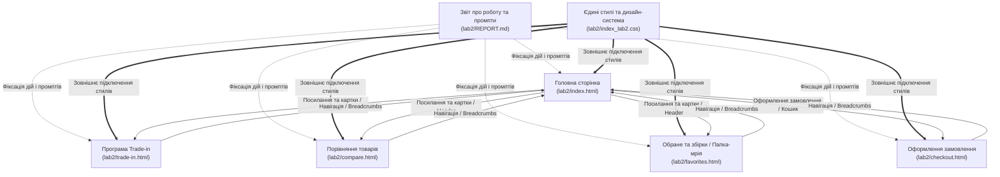

# План виконання: Лабораторна робота №2 (каталог `lab2/`)

## Опис мети
Мета роботи — набути практичних навичок розробки сучасних адаптивних вебсторінок з використанням HTML5, CSS3 та фреймворку Bootstrap 5, а також опанувати методи ефективної роботи з Google Gemini для генерації, оптимізації та адаптації коду.

На даний момент у каталозі `lab2/` реалізовано повноцінну багатосторінкову структуру інтернет-магазину смартфонів та гаджетів **TechPulse** (Етапи 1–4):
1. Робоча область обмежена виключно каталогом `lab2/`.
2. За секціями програм обміну, порівняння характеристик, списків бажань та кошика реалізовано окремі детальні сторінки:
   - `trade-in.html` — розширений онлайн-калькулятор оцінки б/в гаджетів із гнучким вибором стану пристрою, розрахунком суми знижки та формою заявки.
   - `compare.html` — динамічна таблиця порівняння технічних характеристик, цін, оцінок покупців та підсвічуванням кращих значень.
   - `favorites.html` — папка-мрія (обрані гаджети) з можливістю створення іменованих збірок та експорту/завантаження списків у форматі JSON.
   - `checkout.html` — сторінка оформлення замовлення з автоматичним розрахунком підсумкової вартості, вибором способу доставки та оплати.
3. Оновлено головну сторінку `index.html` (динамічна сітка товарів, карусель хітів продажів, зірковий рейтинг, посилання на всі нові сторінки).
4. Оновлено та уніфіковано `index_lab2.css` для збереження єдиної дизайн-системи.
5. Усі запити, згенеровані рішення, правки та результати тестування зафіксовано в детальному звіті `lab2/REPORT.md`.

---

## Графічна схема взаємозв'язків файлів проєкту (Mermaid)

### Текстова структура зв'язків
- **Центральний керуючий файл звітності:** `lab2/REPORT.md` — містить фіксацію всіх запитів, промптів та етапів розробки для кожного файлу сайту.
- **Центральний стильовий файл:** `lab2/index_lab2.css` — імпортується та застосовується на всіх сторінках (`index.html`, `trade-in.html`, `compare.html`, `favorites.html`, `checkout.html`).
- **Головний вузол:** `lab2/index.html` містить посилання в шапці, картках товарів та підвалі на всі 4 нові сторінки.
- **Детальні сторінки:** кожна з додаткових сторінок (`trade-in.html`, `compare.html`, `favorites.html`, `checkout.html`) посилається назад на головну сторінку за допомогою навігаційного ланцюжка (`Breadcrumbs`) та шапки сайту.

---

## Затверджена багатосторінкова навігація

> **Important**  
> **Організація багатосторінкової навігації:** Усі сторінки (`index.html`, `trade-in.html`, `compare.html`, `favorites.html`, `checkout.html`) мають спільний єдиний адаптивний navbar та footer, навігаційні хлібні крихти (`breadcrumb`), індикатори лічильників у шапці, а також спільний файл стилів `index_lab2.css` без порушення існуючої логіки.

---

## Структура та реалізовані компоненти

### 1. Документування та звітність
- **`lab2/REPORT.md`**
  - Тема, мета, завдання роботи.
  - Етап 1: Підготовка та ініціалізація структури `lab2/`.
  - Етап 2: Промпти до Google Gemini для генерації коду кожної секції та нових сторінок, отримані результати.
  - Етап 3: Адаптація, персоналізація (контент, зображення, зелена колірна гама `#1f7a3a`, іконки Bootstrap Icons) та оптимізація.
  - Етап 4: Результати тестування (адаптивність, девайси, валідація, чек-лист працездатності, 100% валідність посилань).
  - Висновки.

### 2. Детальні сторінки (Етап 2 & 3)
- **`lab2/trade-in.html`**
  - Hero-блок із графічною орбітою, хлібними крихтами (`Головна / Trade-in`) та перевагами програми.
  - Форма калькулятора оцінки (модель, орієнтовна ціна, стан корпусу/екрана, контактний номер).
  - Динамічний обчислювач суми знижки з використанням JavaScript та виведенням результату.
- **`lab2/compare.html`**
  - Hero-заголовок та хлібні крихти (`Головна / Порівняння товарів`).
  - Динамічна порівняльна таблиця характеристик (діагональ, екран, процесор, камера, акумулятор, ціна, рейтинг).
  - Підсвічування найкращих параметрів (`.comparison-best`), видалення товарів зі списку порівняння.
- **`lab2/favorites.html`**
  - Управління обраним («Папка-мрія») та створення іменованих збірок покупок.
  - Функціонал вибору товарів, швидкого додавання в кошик, вилучення з обраного.
  - Експорт створиних збірок у JSON-файл для збереження або передачі.
- **`lab2/checkout.html`**
  - Сторінка оформлення замовлення з автоматичним заповненням складу кошика з `localStorage`.
  - Форма введення даних покупця (ПІБ, телефон, email, адреса доставки, спосіб оплати).
  - Підсумок замовлення з підрахунком товарів та доставки (1 ₴).

### 3. Оновлення головної сторінки та стилів
- **`lab2/index.html`**
  - Швидкі дії у Header: Trade-in, Порівняти, Обране, Кошик із динамічними лічильниками.
  - Посилання у Hero-секції та підвалі сайту на нові сторінки.
  - Карусель «Хіти продажів» з можливістю паузи/відтворення.
  - Інтерактивний зірковий рейтинг товарів із підтримкою клавіатурної навігації (WCAG accessibility).
- **`lab2/index_lab2.css`**
  - Додано стилі для хлібних крихт (`.breadcrumb-custom`).
  - Стилі для таблиці порівняння (`.comparison-table`, `.comparison-best`).
  - Стилі для калькулятора Trade-in та візуальних ефектів (`.trade-in-hero`, `.trade-in-orbit`).
  - Забезпечено повну адаптивність для мобільних екранів, планшетів та десктопів.

---

## План верифікації (Етап 4)

### Автоматизовані перевірки
1. **Перевірка наявності та валідності синтаксису HTML/CSS:**
   - Перевірка відсутності незакритих тегів або помилок структури.
   - Тестування локальним сервером (`python3 -m http.server 8000`).
2. **Перевірка лінків та ресурсів:**
   - Перевірка внутрішніх посилань між `index.html`, `trade-in.html`, `compare.html`, `favorites.html` та `checkout.html` (відсутність 404 помилок).

### Ручне тестування (Manual Verification)
1. Відкрити сторінки на різних роздільних здатностях (Mobile 375px, Tablet 768px, Desktop 1200px+).
2. Перевірити роботу гамбургер-меню Bootstrap на мобільних пристроях на всіх сторінках.
3. Перевірити роботу інтерактивних фільтрів та калькуляторів.
4. Перевірити збереження стану кошика, обраного та порівняння у `localStorage`.
5. Перевірити валідацію форм оформлення замовлення та оцінки Trade-in.